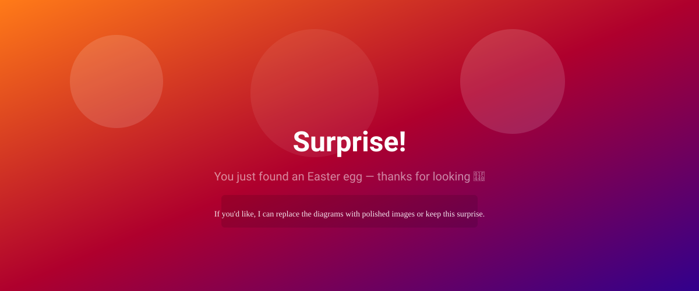
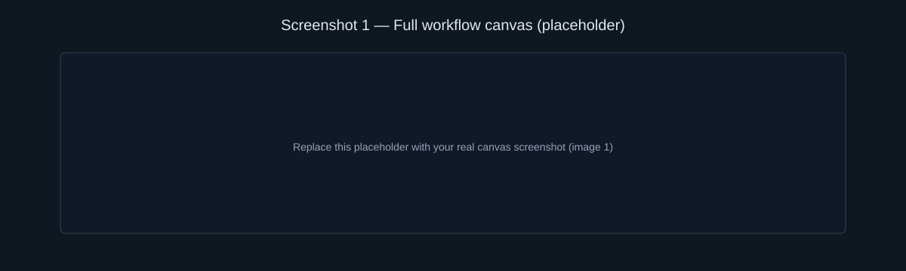
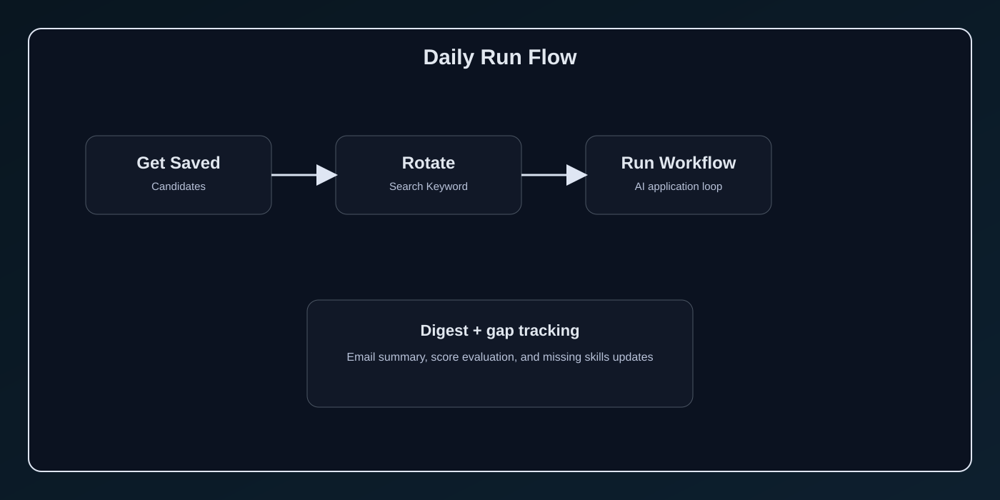
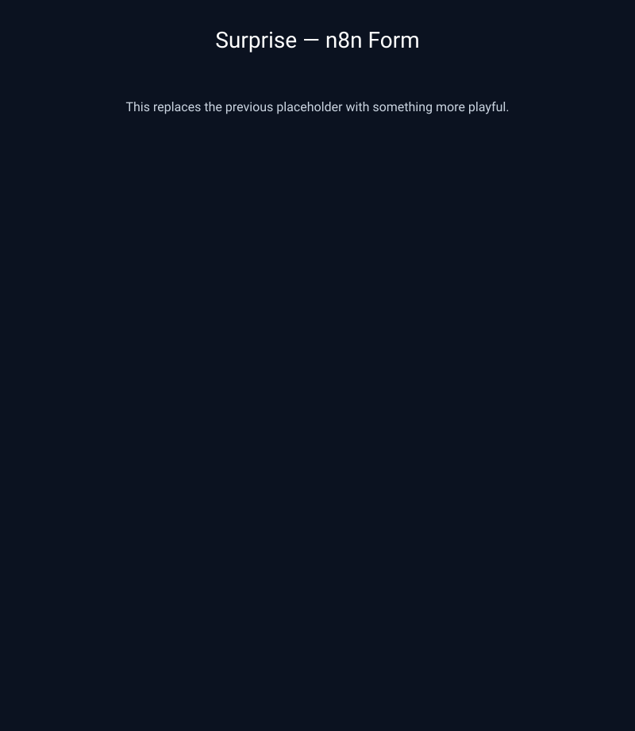

# Drogon AI Agent 1.0

Drogon AI Agent 1.0 is a set of n8n workflows for AI-assisted job searching and application management. It combines:

- candidate intake from a form
- LinkedIn job discovery via Apify
- AI scoring and filtering
- resume tailoring and cover letter generation
- recruiter contact lookup
- Google Sheets tracking
- weekly skills-gap summaries

This repository contains the actual workflow exports for the system and a clean operational setup guide.

## Project overview



## Workflow screenshots

### 1. Full workflow canvas



### 2. Daily run flow



### 3. Weekly summary flow


### 4. Job application form



## Included workflows

1. `workflows/Drogon Ai Agent 1.0.json`
   - Main job application agent workflow
   - Accepts candidate details through an n8n form
   - Stores the candidate in a data table
   - Searches LinkedIn jobs
   - Filters and scores matches with AI
   - Tailors the CV and cover letter
   - Finds recruiter email addresses
   - Tracks jobs in Google Sheets and emails a daily digest

2. `workflows/Job Agent - Daily Run.json`
   - Daily scheduled workflow
   - Loads saved candidates
   - Rotates the search keyword to avoid repetitive queries
   - Runs the main job agent for each candidate automatically

3. `workflows/Drogon Ai Agent 1.0- Weekly Skills Summary.json`
   - Weekly Monday summary workflow
   - Reads the gaps tracker sheet
   - Aggregates the most common missing skills
   - Sends a personalized email to each candidate

## Workflow architecture overview

```text
Candidate Form / Daily Schedule
        │
        ▼
Save candidate data
        │
        ▼
Scrape LinkedIn jobs
        │
        ▼
AI fit scoring + filtering
        │
        ├── Good fit → tailor CV + cover letter + recruiter lookup
        │
        └── Weak fit → log gaps in tracker
                │
                ▼
        Weekly summary of missing skills by email
```

## Prerequisites

Before importing these workflows into n8n, make sure you have:

- n8n instance running
- Gmail OAuth credentials
- Google Sheets OAuth credentials
- Apify API token for LinkedIn jobs scraping
- OpenAI API access through n8n's AI model integration
- a data table named `job_agent_candidates`
- Google Sheets files for:
  - Job Applications Tracker
  - Resume Gap Tracker v2

## Required setup

### 1. Import workflows

Import the files from `workflows/` into your n8n workspace.

### 2. Reconnect credentials

Reconnect all credential nodes after import:

- `Google Sheets account`
- `Gmail account`
- `Apify API Token (Drogon M)`
- `Gateway credits` / OpenAI credentials

### 3. Confirm data sources

Check these IDs and names in the workflow JSON against your actual n8n resources:

- `job_agent_candidates` data table
- Google Sheets document IDs
- relevant sheet names
- workflow references for `Execute Workflow` nodes

### 4. Test safely

Run the workflows in a safe environment before activating daily automation.

## Operational notes

This project is designed to automate job applications with human review before sending anything to employers. The workflow keeps the candidate in control by:

- filtering jobs before outreach
- scoring match quality
- generating tailored CV and cover letter text
- allowing manual review before final sending
- tracking resume gaps for weekly upskilling reports

## Security recommendations

- never expose API keys in exported workflow files
- store secrets in n8n credentials, not in plain JSON or repo files
- rotate API tokens periodically
- check job emails, recruiter outreach, and web-based contact findings before sending

## Project structure

```text
.
├── README.md
├── LICENSE
├── CHANGELOG.md
├── CONTRIBUTING.md
├── .env.example
├── .gitignore
├── docs/
│   ├── ARCHITECTURE.svg
│   ├── SETUP.md
│   ├── screenshots/
│   │   ├── 1.svg
│   │   ├── 2.svg
│   │   ├── 3.svg
│   │   └── 4.svg
│   └── WORKFLOW_GUIDE.md
├── scripts/
│   └── validate-workflows.js
├── workflows/
│   ├── Drogon Ai Agent 1.0.json
│   ├── Job Agent - Daily Run.json
│   ├── Drogon Ai Agent 1.0- Weekly Skills Summary.json
│   └── README.md
├── package.json
└── .n8n/
```

## Recommended next improvements

To make this repo even stronger, add:

- a visual workflow diagram
- screenshots of the n8n setup
- example sheet schema for trackers
- step-by-step onboarding checklist
- credential validation guide
- changelog and versioning notes

## Summary

This repository is not just a concept—it includes the actual n8n export workflows for:

- job search automation
- daily follow-up execution
- weekly skills-gap reporting

The foundation is strong and now reflects a real operational AI automation system.
